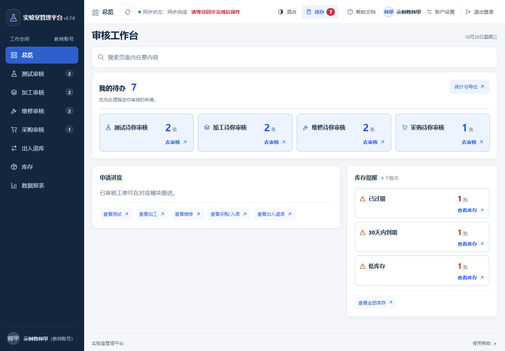
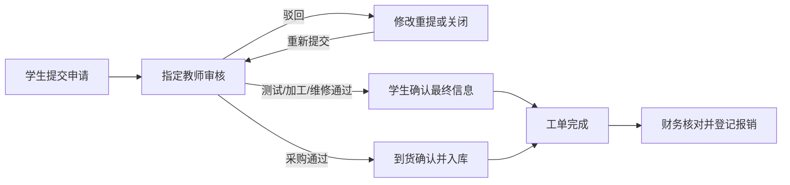
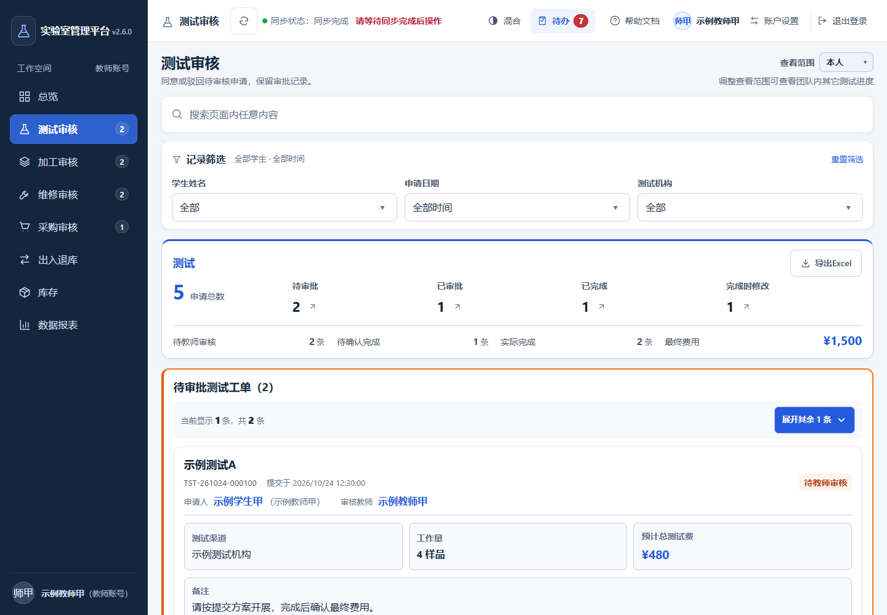
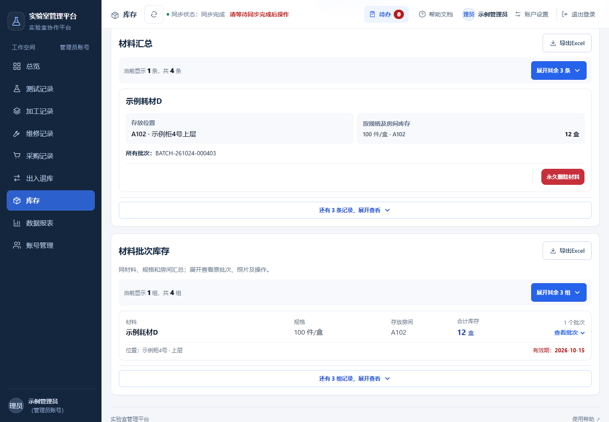
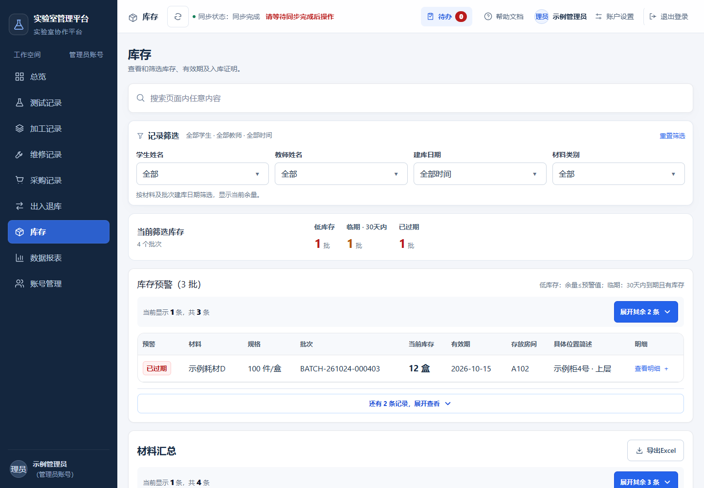
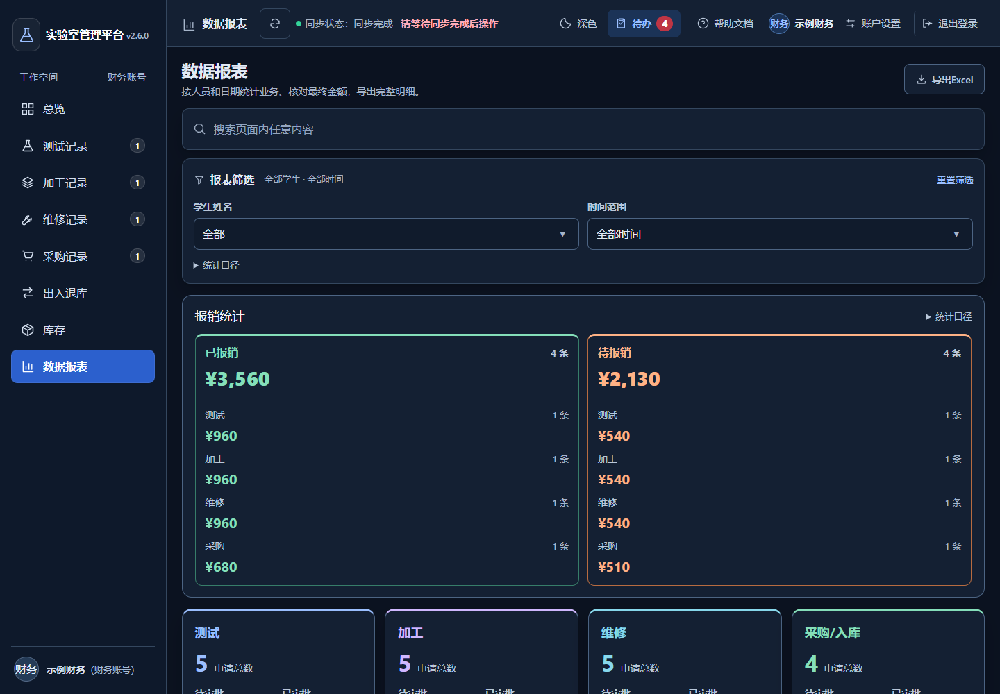
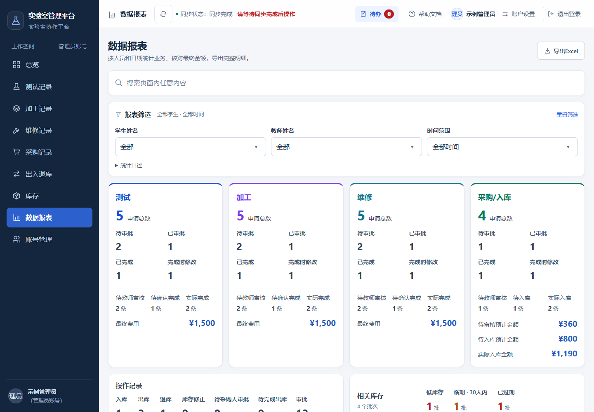
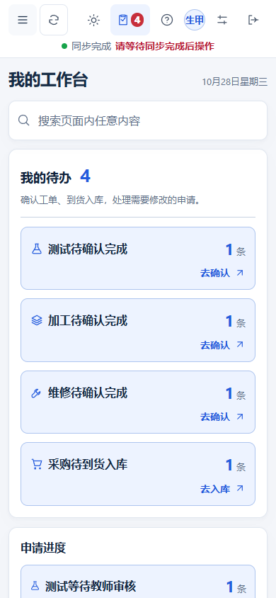
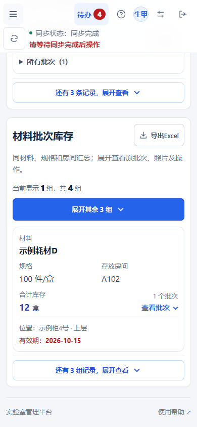
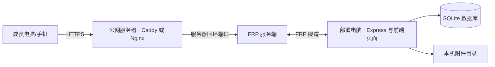

# 实验室管理平台

把测试、加工、维修、采购入库、库存和报销放在同一个工作空间。面向学生、教师、财务和管理员，支持电脑与手机访问，可部署在自己的电脑上。

[](https://github.com/MoonFlowsR/lab-platform/actions/workflows/check.yml)
[MIT License](LICENSE) · Node.js 24.x · React 19 · Express 5 · SQLite



**本文截图均使用虚构账号和示例数据。下载源码后是空业务系统，截图中的账号、材料和工单不会预置。**

[功能与角色](#功能与角色) · [界面示例](#界面示例) · [快速部署](#快速部署) · [后台运行](#后台运行) · [跨网络访问](#跨网络访问) · [数据与备份](#数据与备份) · [开发与维护](#开发与维护) · [更新记录](docs/CHANGELOG.md)

## 功能与角色

| 模块 | 主要功能 |
| --- | --- |
| 角色工作台 | 按身份显示审核、确认完成、到货入库、采购人审批和报销等待办，点击进入对应处理页 |
| 测试、加工、维修 | 指定教师审核；学生确认最终工作量、费用和工单状态；保留完成时修改记录 |
| 采购与入库 | 采购申请、到货核实、最终金额确认、物品照片与存放信息，完成后形成库存批次 |
| 库存 | 现有材料建库、材料汇总与原始批次、规格和位置查询，低库存、临期及过期提醒 |
| 出库与退库 | 学生登记领用和归还，审批本人采购物品的领用申请；采购人本人领用可直接登记，其他角色查看全部记录 |
| 财务与报表 | 已开票/已挂账、待报销/已报销、按类别统计最终费用，筛选后导出 Excel |
| 搜索与附件 | 页面搜索并高亮、可检索下拉菜单、日期与身份筛选、照片及附件查看下载 |
| 帮助与管理 | 分角色操作说明、正文评论和留言回复、账号管理、带操作端信息的审计日志 |

| 身份 | 日常工作 |
| --- | --- |
| 学生 | 完善个人资料，提交申请，确认最终信息，采购入库、材料建库、出库退库和采购物品领用审批 |
| 教师 | 审核指定给自己的工单，查看同学生近期同类记录，查询团队业务与库存 |
| 财务 | 默认查看全组记录，核对最终金额和票据状态，登记报销，导出对账明细 |
| 管理员 | 查看团队情况，管理账号、物品信息和业务记录，查询操作日志 |

学生和教师可切换“本人/全部”查看业务进度；审核仍由工单指定的教师处理。成员的逐步操作说明在平台内“帮助文档”。

支持浅色、深色、混合三种界面，也可选择跟随系统；登录页、工作台及帮助页均可切换，选择保存在当前浏览器。

### 从申请到完成



- **测试、加工、维修**：教师通过后，学生再确认最终工作量、单位、总费用和“已开票/已挂账”。确认时修改的信息单独标记，统计使用最终费用。
- **采购**：到货后确认实际数量、单位、总金额和工单状态，填写有效期、存放房间与位置简述，上传物品特写后完成入库。
- **记录分类**：待审批、已审批、已完成、完成时修改。业务记录默认显示最新一条，同时显示总数，可展开其余记录。
- **导出**：导出当前筛选下的全部匹配记录，使用中文列名；Excel 自带表头筛选与冻结。库存分别提供汇总和批次明细。

## 界面示例

### 教师审核

待办与历史记录分开，申请人、审核教师和金额集中展示。待审核工单可展开查看该学生近半年在同一机构进行相同测试或加工的记录。



### 库存查询

库存预警、材料汇总与批次记录分层显示。材料汇总便于查找，批次保留采购人、入库人、规格、位置、有效期和凭证；两部分可分别导出。



<details>
<summary><strong>查看库存预警、财务报销和数据报表界面</strong></summary>

低库存、临期和过期物品单列提醒；财务按测试、加工、维修和采购核对报销事项；数据报表展示各类别的数量、最终费用和业务明细。







</details>

### 手机使用

手机采用导航抽屉和记录卡片，保留待办、范围筛选、附件及导出操作。

<table>
  <tr><th>学生工作台</th><th>库存查询</th></tr>
  <tr>
    <td></td>
    <td></td>
  </tr>
</table>

## 快速部署

### 1. 准备环境

安装 [Node.js 24.x](https://nodejs.org/en/download)，保留附带的 npm。下载仓库 **Code → Download ZIP** 并解压，或使用 Git：

```sh
git clone https://github.com/MoonFlowsR/lab-platform.git
cd lab-platform
```

以下命令都在包含 `package.json` 的项目目录执行。

### 2. 初始化并启动

```sh
npm run setup
npm ci
npm run local
```

浏览器打开 **[http://localhost:3001/](http://localhost:3001/)**。

| 命令 | 作用 |
| --- | --- |
| `npm run setup` | 生成本机 `.env`，包括服务配置、认证密钥及四类注册码 |
| `npm ci` | 按锁定版本安装依赖 |
| `npm run local` | 构建前端并启动平台 |

### 3. 注册账号

四类注册码在 `.env` 中，建议按以下顺序建立账号：

1. **管理员**：使用 `ADMIN_INVITE_CODE`。首个管理员自动启用，后续管理员由已有管理员启用。
2. **教师**：使用 `TEACHER_INVITE_CODE`，注册后由管理员启用。
3. **学生**：使用 `STUDENT_INVITE_CODE`，首次登录选择系统责任教师、实际指导教师及毕业年份。
4. **财务**：按需使用 `FINANCE_INVITE_CODE` 注册，由管理员启用。

默认使用姓名登录。测试/加工名称、机构、材料及采购渠道从实际录入中积累；没有合适选项时选择“其它”，保存后可继续选用。计量单位等基础选项已有预设。

### 4. 开始使用

已有物品由学生在 **库存 → 开始录入现有材料** 建库；新购物品按 **采购申请 → 教师审核 → 到货入库** 流转。之后在库存查询，在出/退库登记领用和归还。

## 后台运行

### 前台运行

完成首次构建后，可以直接启动已有版本：

```sh
npm run server
```

该方式随终端关闭而停止。另开终端执行 `npm run check` 可检查服务状态。

### Windows 静默后台

先按 **Ctrl+C** 停止前台服务，以管理员身份打开 PowerShell，在项目目录运行：

```powershell
powershell -NoProfile -ExecutionPolicy Bypass -File scripts/service.ps1 -Action Install
```

安装后开机启动，每分钟检查并恢复平台服务；注销桌面后仍可运行，无命令行窗口或弹窗。也可双击 `start-platform.vbs` 启动，重复启动会复用正常服务。

部署电脑需持续开机、联网并关闭自动休眠。Windows 后台任务管理平台服务，FRP 隧道需单独设置启动与恢复。

移除后台任务并停止平台：

```powershell
powershell -NoProfile -ExecutionPolicy Bypass -File scripts/service.ps1 -Action Remove
```

## 跨网络访问

`localhost` 仅供部署电脑访问。让异地成员通过域名使用平台，需要配置公网服务器、域名、HTTPS 和 FRP 隧道。



1. 在公网服务器运行 `frps`，在部署电脑运行 `frpc`。
2. 将本机 `127.0.0.1:3001` 转发至服务器的回环端口，例如 `127.0.0.1:18080`。在 `frps.toml` 设置 `proxyBindAddr = "127.0.0.1"`，在 `frpc.toml` 设置 `remotePort = 18080`；两端配置相同的 FRP 认证密钥。
3. 域名添加 DNS A 记录，指向服务器公网 IP。
4. 服务器通过 Caddy 或 Nginx 提供 HTTPS，反向代理至上述回环端口。
5. 分别配置平台、`frpc`、`frps` 与 HTTPS 服务的后台启动和异常恢复。
6. 手机关闭 Wi-Fi，用移动网络检查域名访问、登录、同步、上传和下载。

例如，Caddy 的网站入口可写为：

```caddyfile
lab.example.org {
    reverse_proxy 127.0.0.1:18080
}
```

将示例域名替换为自己的域名。服务器的 80/443 用于网站和证书，FRP 控制端口用于隧道连接；转发端口与本机 3001 保持回环监听。

数据库和附件仍保存在部署电脑；公网服务器转发访问请求。电脑关机、休眠、断网或隧道停止时，异地访问会中断。GitHub 提供源码，平台需按以上方式部署运行。

## 数据与备份

### 文件位置

| 路径 | 内容 |
| --- | --- |
| `.env` | 服务配置、认证密钥和注册码 |
| `src/config/` | 平台名称、基础选项及业务类型配置 |
| `server/data/lab_platform.db` | 账号、业务工单、库存、审批、评论和审计记录 |
| `server/uploads/` | 物品照片和其他附件 |
| `server/backups/` | 自动生成的数据库和配置备份 |
| `server/logs/` | 服务与运行监测日志 |
| 同级 `项目名-backups/` | 手动完整备份 |

账号和业务数据由部署端保存，密码使用 bcrypt 哈希。日常浏览器操作通过平台接口读写数据库及附件。

### 两种备份

| 方式 | 时机与内容 |
| --- | --- |
| 自动备份 | 启动时及每小时执行，保留 72 套数据库与配置快照，不含附件 |
| 完整备份 | 执行 `npm run backup`，保存数据库、附件、配置、程序及构建，并进行完整性校验 |

```sh
npm run backup
```

完整备份位于同级 `项目名-backups/full-时间戳/`。建议另存一份到其他磁盘或私有存储。恢复前停止服务及监测，先备份当前状态，再按同一备份恢复数据库、配置与附件。

## 开发与维护

### 常用命令

| 命令 | 用途 |
| --- | --- |
| `npm run dev` | 启动 Vite 前端开发环境 |
| `npm run build` | 构建前端，保留旧资源以兼容已打开的页面 |
| `npm run server` | 运行 Express 服务与已构建的前端 |
| `npm run check` | 检查平台运行状态 |
| `npm run lint` | 代码静态检查 |
| `npm test` | 业务与安全测试 |
| `npm run test:ui` | 使用虚构数据检查电脑和手机界面 |
| `npm run privacy:check` | 检查公开源码中的隐私和部署信息 |

前端开发时，在另一个终端启动 `npm run server`，Vite 会将 `/api` 请求代理到后端。首次运行界面测试前执行：

```sh
npx playwright install chromium
npm run test:ui
```

### 配置与目录

`src/config/platform-settings.json` 集中设置平台标题、房间、毕业年份范围及登录方式。`loginIdentifier` 默认 `name`；改为 `identifier` 后，注册时分别填写登录账号和姓名，以支持同名成员。配置修改后重新构建并重载服务。

```text
src/
  app/                  工作区布局、页面装配和前端配置
  features/             账号、工单、采购、库存、财务、报表、帮助
  shared/               搜索、筛选、附件、同步和 Excel 导出
  config/               平台设置、业务类型和基础菜单
  styles/               设计变量及公共样式
server/
  routes/               接口与鉴权
  features/             业务校验和领域规则
  services/operations/  申请、审批、入库等数据库操作
  db/、queries/         数据存储与查询
  security/             登录限流、会话失效等安全规则
scripts/                初始化、启动、备份及更新工具
tests/                  业务、安全和浏览器界面检查
```

具体修改入口见 [代码导航](docs/CODE-MAP.md)，布局维护见 [界面维护](docs/UI-GUIDE.md)，更新及回滚见 [维护说明](docs/MAINTENANCE.md)。

GitHub Actions 自动运行隐私检查、lint、构建、业务与安全测试、生产依赖安全审计及浏览器界面测试。修改后先在独立副本验证，再更新部署版本。

## 许可

采用 [MIT License](LICENSE)，允许使用、修改和分发，保留许可证及版权声明。
